# Material 3 redesign: design and implementation side by side

**Source:** `Frontend_redesign_brief.zip` (2026-11-01). It holds three directions (Material 3,
a panel workspace, a quiet viewer) and a rebuild of the old UI for comparison. The brief's
cover image and its full-app file, `CanViewer Material.dc.html`, are the Material direction,
so that is the one implemented. The brief itself is not in the repository.

`design/` holds renders of `CanViewer Material.dc.html` at 1440 × 900 with its demo data,
which mirrors `examples/demo.dbc`. The brief's runtime loads React and Babel from unpkg;
for the renders those three files were served from local npm copies of the same versions.
`app/` holds the implementation, a production build with `examples/demo.dbc` open, in the
same states: same message and signal, same hex payload, same theme.

| Screen | Design | App |
|---|---|---|
| Message, light (EngineData, EngineSpeed selected) | 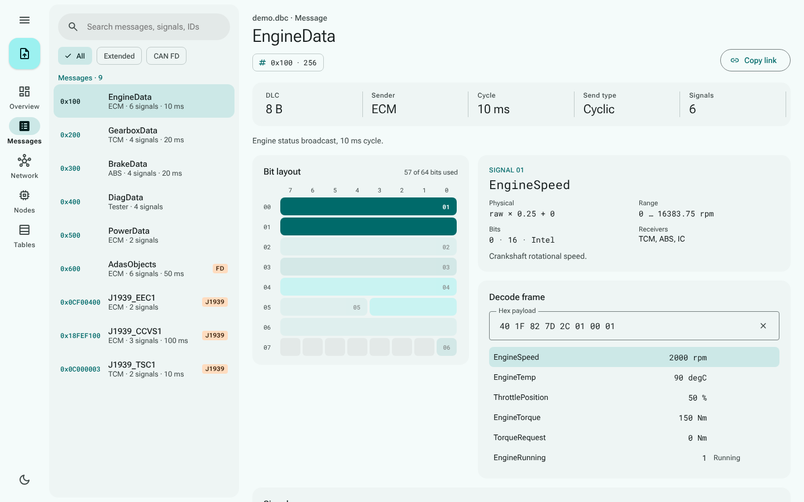 | 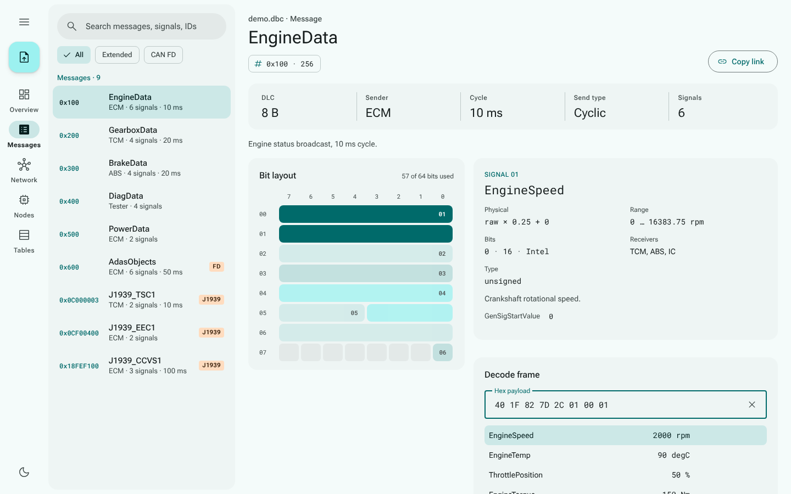 |
| Overview, light | 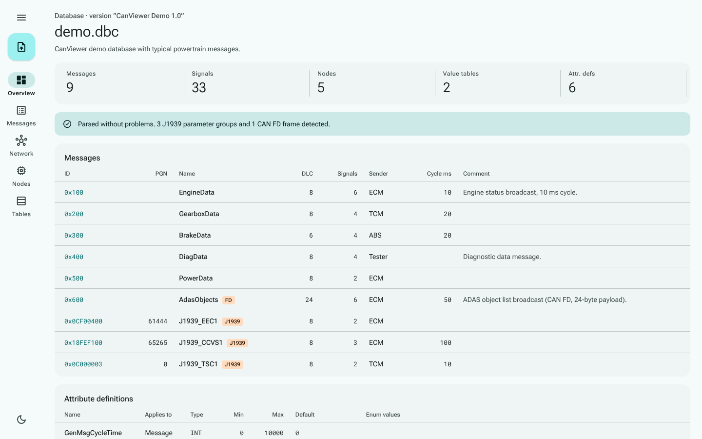 | 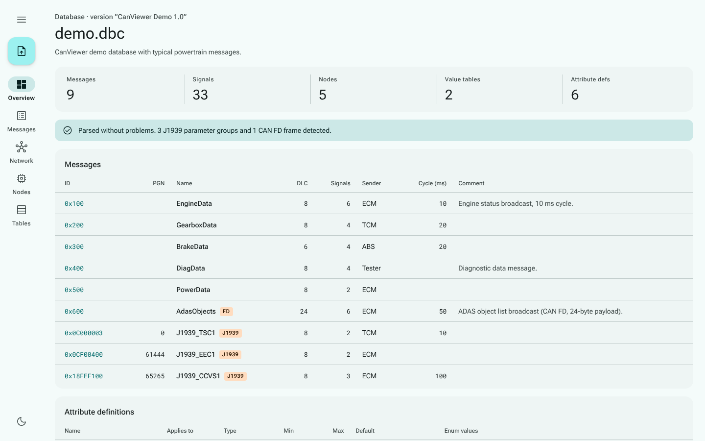 |
| Message, dark (BrakeData, payload `13 88 13 92 0C 80`) | 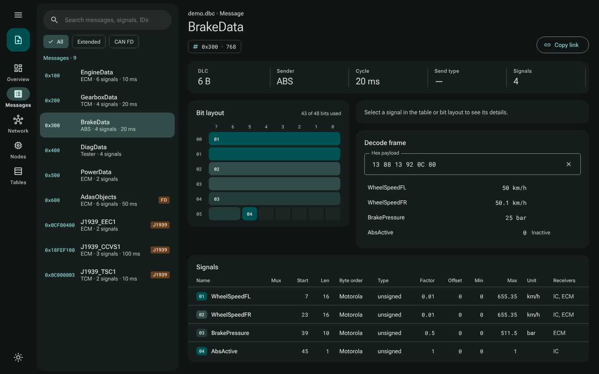 | 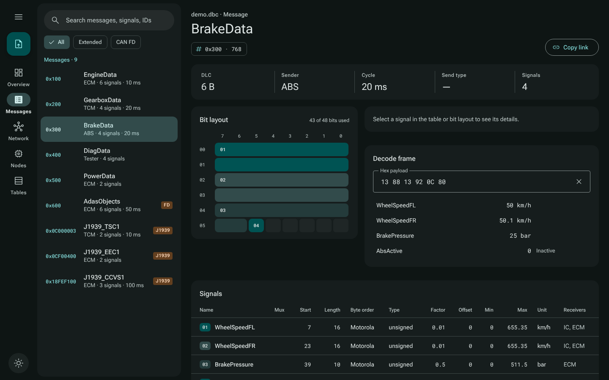 |
| Network, ECM selected | 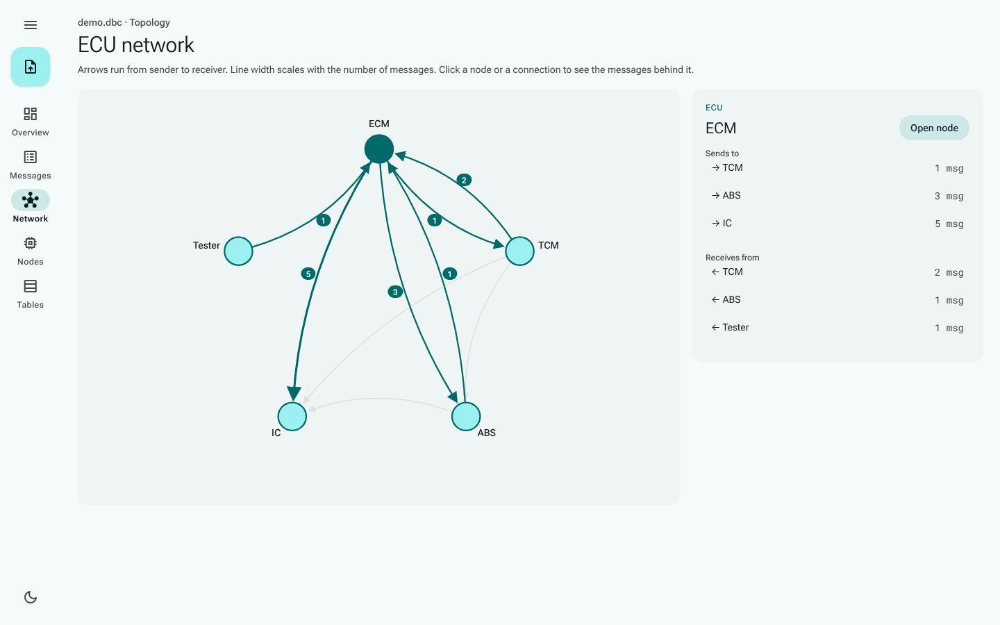 | 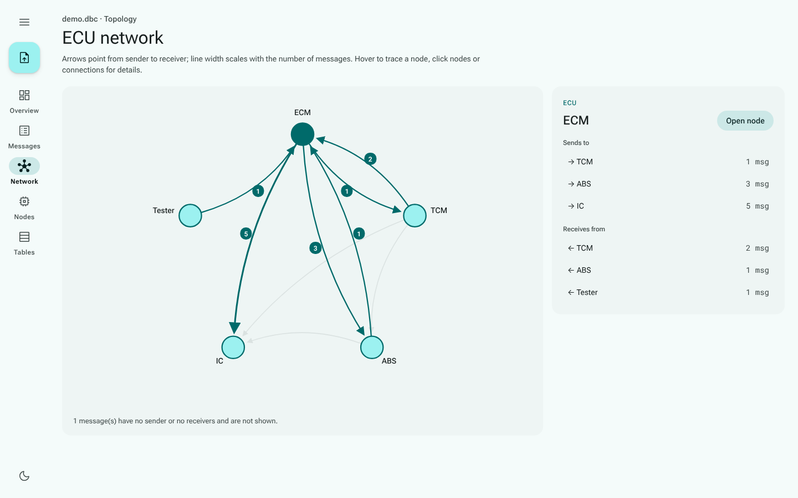 |
| Nodes | 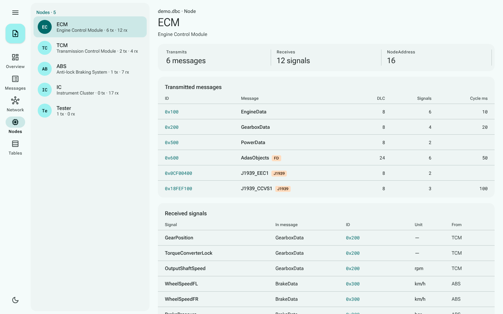 | 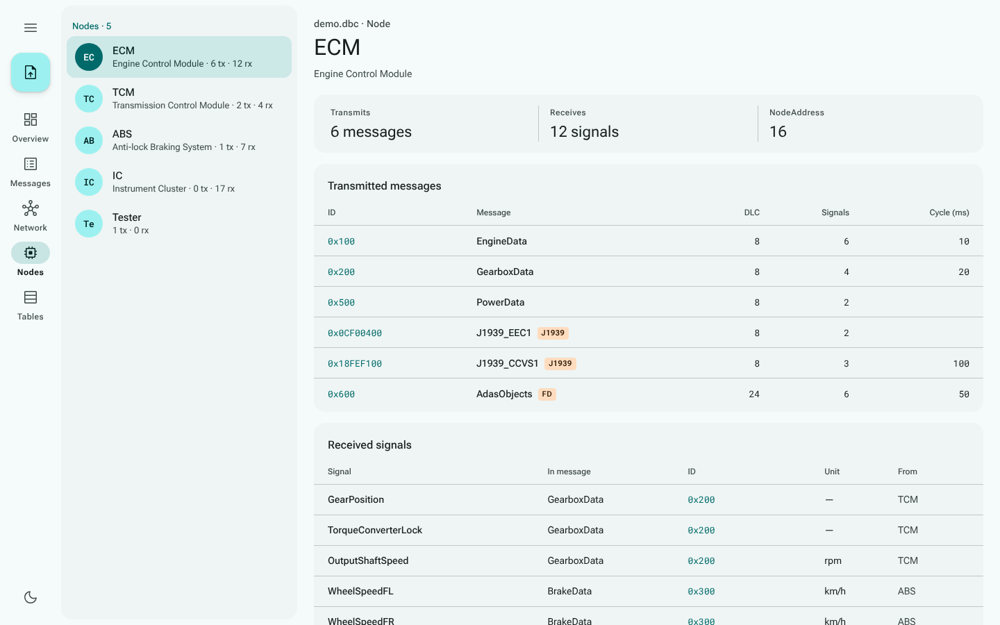 |
| Value tables |  | 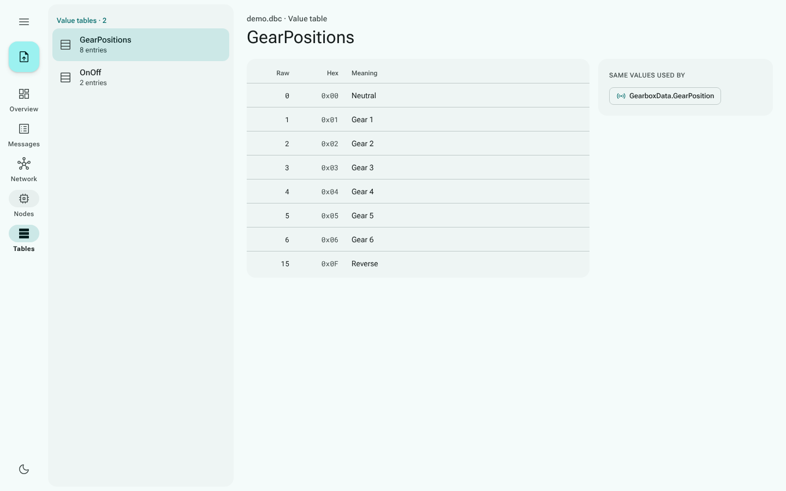 |

Screens the design does not show, as implemented:

| Screen | App |
|---|---|
| Welcome (no file open) | 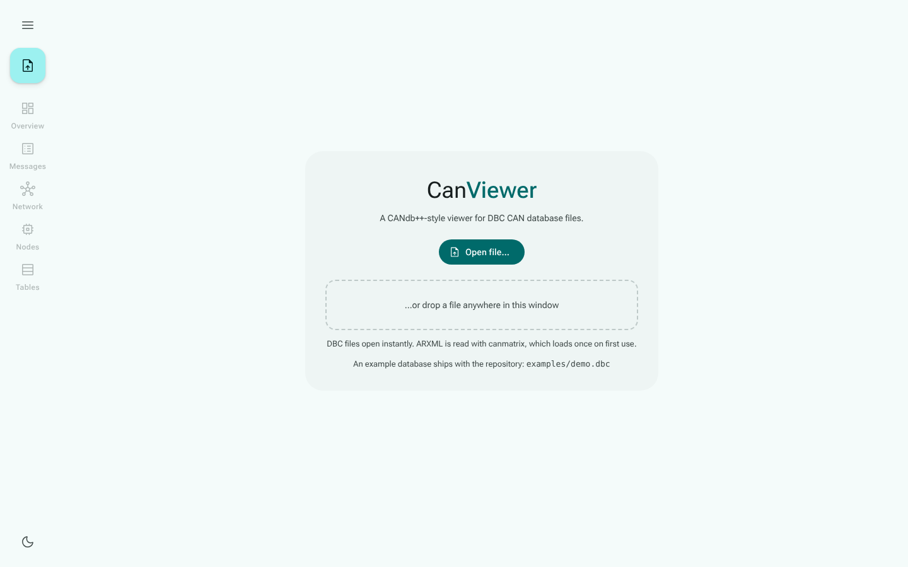 |
| CAN FD frame, 24 bytes, dark | 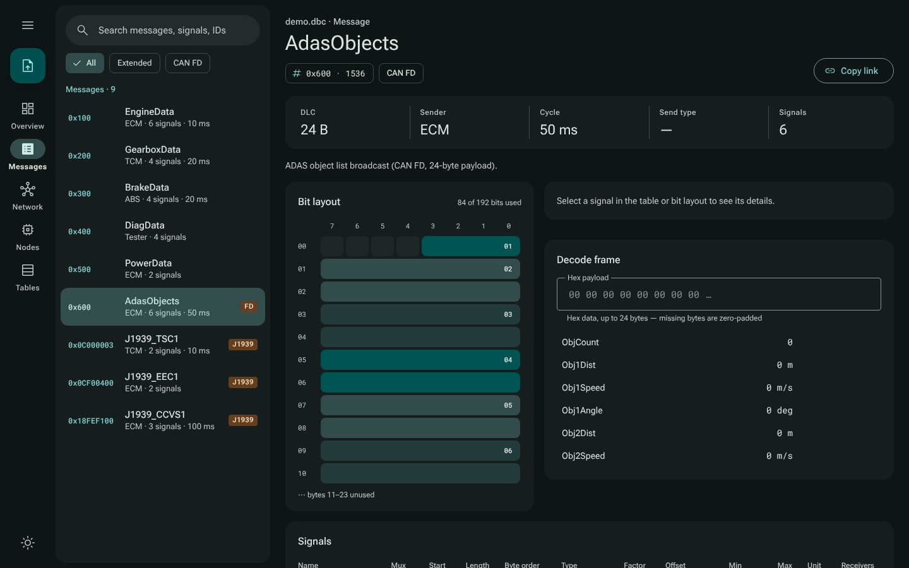 |
| Parse problems (`vw_mqb.dbc` from opendbc) | 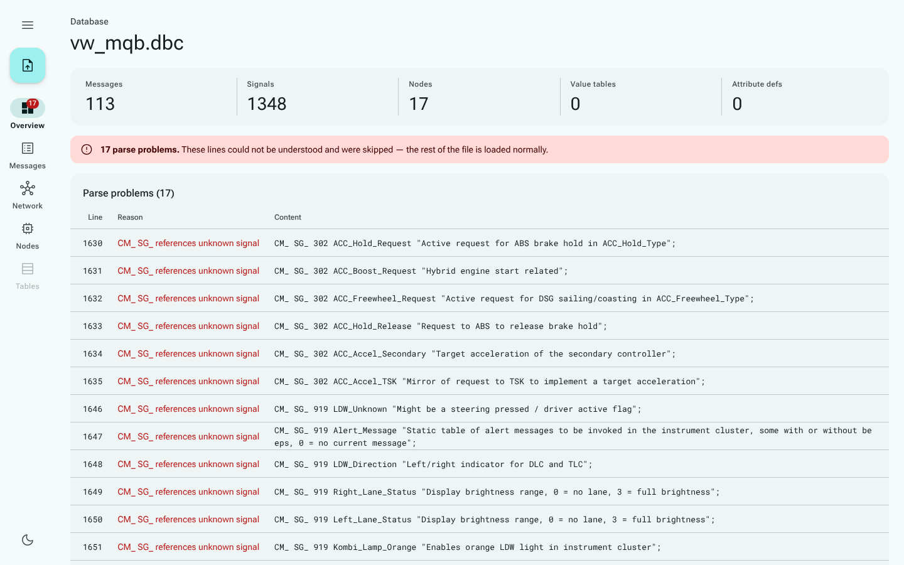 |
| German UI | 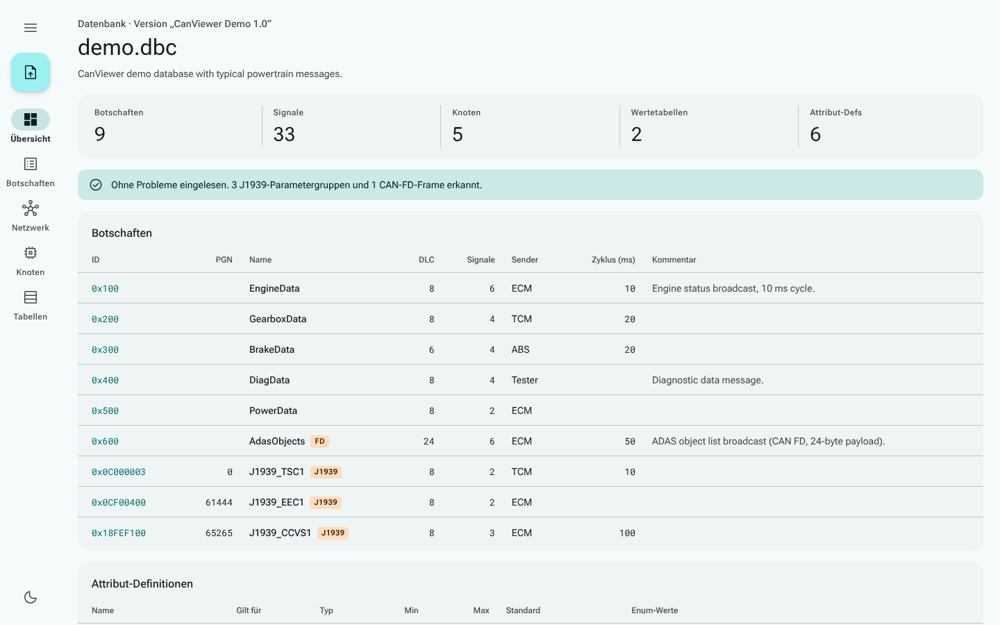 |

## Where the app differs from the design, and why

- **Fonts and icons are bundled.** The design loads Roboto Flex, Roboto Mono and Material
  Symbols from Google Fonts. The app ships the Latin subsets of the two fonts (woff2,
  144 KB, `src/fonts.css`) and the 28 icons it uses as inline SVG paths
  (`src/components/icon-paths.ts`), so it still makes no request outside its own origin.
- **Nothing the old UI showed is dropped.** The signal card adds the value type and the
  signal's attributes. Messages keep their attributes card, warnings and frame-size notes
  (as banners). The network page keeps the note on messages without sender or receivers.
  The overview keeps parse problems (error banner and table) and skipped statements.
- **The decoder starts empty.** The design prefills sample payloads, which a DBC file does
  not contain. An empty field decodes as all zero bytes, and the parsed bytes are echoed
  when the input is shorter or longer than the DLC.
- **Additions the design leaves open:** the menu button opens the language setting, the
  theme follows the system until toggled, an imported file's loading stage and errors
  appear as a snackbar, and rail destinations with nothing to show are disabled.
